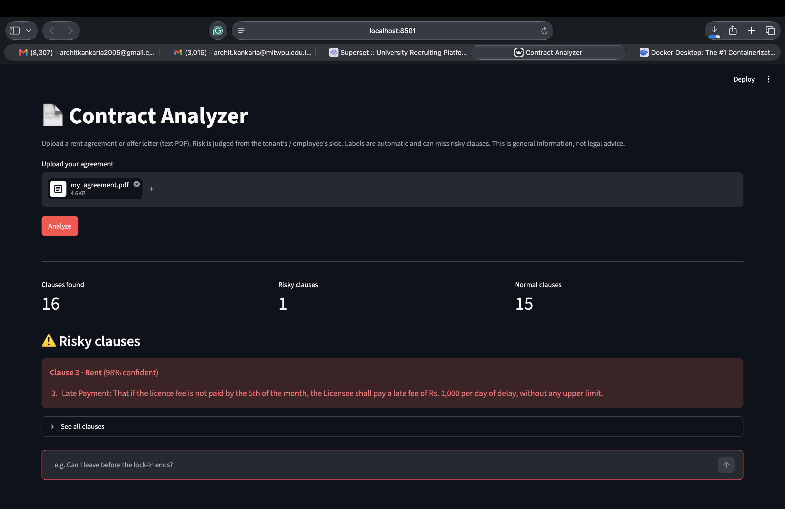

# Contract Analyzer – AI risk checker for rent agreements & offer letters

Upload a rent agreement or offer letter. A fine-tuned DistilBERT model labels every clause
and flags risky ones; a RAG pipeline answers questions with citations to the clause and Indian law.

## Features
- Clause classification (type + Normal/Risky) with a fine-tuned DistilBERT model
- Risk dashboard highlighting one-sided clauses
- Q&A over the document and Indian law (Contract Act 1872, Model Tenancy Act 2021, Maharashtra Rent Control Act 1999)
- Multi-LLM fallback: Gemini → Groq (gpt-oss, Qwen)
- Privacy: party details removed, PAN/Aadhaar/phone masked before storage or LLM calls
- FastAPI backend + Streamlit frontend, Dockerized

## Architecture
PDF → parser (split + mask) → DistilBERT (type, risk) → ChromaDB (clauses + labels)
Question → embedding search (clauses + law library, cosine similarity, threshold) → LLM → cited answer

## Tech stack
Python, Hugging Face Transformers (DistilBERT), scikit-learn, ChromaDB, Gemini API, Groq API,
FastAPI, Streamlit, Docker

## Results (188 labeled clauses, 47-clause held-out test set)
| Metric | TF-IDF + LR | DistilBERT |
|---|---|---|
| Clause type macro F1 | 0.83 | 0.91 |
| Risk macro F1 | 0.84 | 0.82 |
| Risky recall | 0.70 | 0.75 |

## Error analysis
On a new, realistic agreement the classifier caught only 1 of 9 risky clauses with ~99% confidence.
It had learned a shortcut (Licensor/Licensee wording → Normal) and is overconfident due to small data.
Mitigation: the LLM re-checks every clause; next step is more varied training data.

## How to run
### With Docker
1. Create `.env` with GEMINI_API_KEY and GROQ_API_KEY
2. Put the trained models in app/model_clause_type and app/model_risk
3. docker compose up --build
4. Open http://localhost:8501

### Without Docker
pip install -r requirements.txt
python -m uvicorn app.main:app --reload
python -m streamlit run ui/streamlit_app.py

## Limitations
- Small dataset (188 clauses); risk labels reflect the tenant/employee view
- Text PDFs only (no OCR for scans)
- Law library has no employment laws; law chunks are split by page, not by section
- Not legal advice

## Screenshots
